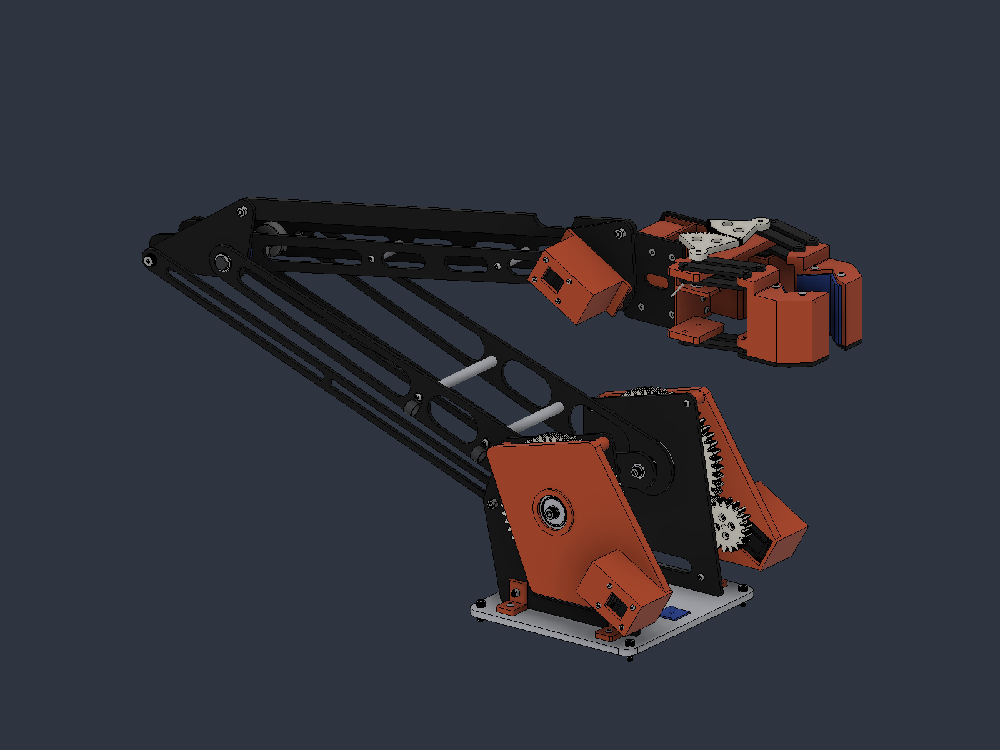

# ARC S2 Engineer Arm: donut + pipe tasks

Adapted from Wang et al., *Lightweight Robotic Arm Based on a Load-Adaptive Hoisting Mechanism*, Actuators 2025, 14, 71.
Task requirements come from the ARC Championship Events Manual S2 v1.0, §3.2.4 (Objectives B and C) and §3.2.4.5 (Controlling Objectives).

## Where to look

| You want | Go to |
|---|---|
| What the arm is and the evidence that it meets the requirements (masses, torques, margins, safety factors) | [cad/docs/ARC_S2_Engineer_Arm.pdf](cad/docs/ARC_S2_Engineer_Arm.pdf), the one product document, rebuilt from the check results by `cad/docs/paper/make_paper.py` |
| The design the team edits | Autodesk Fusion, project folder *ARC S2 Engineer Arm*: assemblies *ARC Arm Rev B* (STS3215 + 3:1 spur stage on J1/J2) and *ARC Arm Rev A* (DM-J4340 direct drive), shared four-bar gripper. Their exported state and the checks on it: [fusion/README.md](fusion/README.md) |
| The code-CAD reference model and its checks | [`cad/MAP.md`](cad/MAP.md) (generated: every module, parameter, interface, envelope and part, with the line that builds it) and [`CLAUDE.md`](CLAUDE.md) (conventions, frames, check workflow, guard rails) |
| The simulation and the task video | [sim/README.md](sim/README.md) |

## Current state

- **Design: rev B, `GRIP=FOURBAR`.** Gear-synchronised parallel four-bar gripper on a palletizer arm with parallelogram level keeping, Feetech STS3215 servos on every joint (J1/J2 through a printed 3:1 spur stage).
- **Fusion is the design master.** The team edits there. Each version is exported to `fusion/snapshot/<rev>/` as text and checked against the code-CAD. The code-CAD (FreeCAD 1.1 Python) stays as the reference that the requirement checks, FEA and simulation run on.
- **Base-drive variant (`BASE_DRIVE=DIRECT`).** The DM-J4340-2EC direct drive on J1/J2 (Fusion rev A) is kept to compare base motors. Its outputs are in `cad/out/fourbar_direct/`.
- **Released package (2026-11-19).** `cad/fab/` (STEP, DXF, BOM, procurement), `cad/fea/out` and `cad/render/out` hold rev B as released. It predates the 2026-11-21 base shrink and the gripper-palm fix, and is re-exported only on request. There are no drawings; they are not a requirement.

## What the arm does

| Task | Requirement (manual) | How the arm does it |
|---|---|---|
| **Donut** (Obj C) | Ø100/Ø50×25 ring around the base of a 456 mm zig-zag pole on the 210 mm lower tier; score it lying flat on the 300×300×50 Scoring Area. | Jaws close on the 100 mm OD, fingers forward. Lift it up the pole following the zig-zag (arm Z, wrist roll, chassis strafe for Y) until it clears the top at 666 mm, then place it flat. |
| **Pipe** (Obj B) | 500 mm × Ø26.7 PVC pipe in a Ø200×250 bucket; turn it in through a Ø52.5 chute 600 mm up. | Grip the nearest pipe by its top end in the pad V-notches, lift it clear of the rim (TCP at 740), pitch the wrist 90° so it points forward; the chassis drives it ~300 mm into the chute. |
| **Fail-safe** (§3.2.4.5) | Within 1 s of being defeated, stop controlling objectives; the claw must release unpowered. | A torsion spring on the right drive pivot biases the jaws open and back-drives the unpowered gripper servo. **Bench-test the back-drive torque and the release time** (open item 1). |

## Layout

| Path | What it holds |
|---|---|
| `cad/arm/` | The model, one module per subassembly; `cad/arm_model.py` re-exports it (`import arm_model as M`). |
| `cad/params/`, `cad/interfaces/`, `cad/envelopes/`, `cad/data/catalogue.toml` | Design inputs, mating interfaces, field keep-out boxes, purchased parts. Edit these, not literals in code. |
| `cad/hardware.py`, `cad/vendor/` | Purchased-part geometry: vendor STEP (STS3215, DM-J4340), ISO/DIN hardware, catalogue-modelled parts. |
| `cad/field.py` | ARC Battlefield items (tier, placeholder pole, bucket, pipes, scoring area, chute). |
| `cad/tools/`, `cad/check_interference.py`, `cad/tests/` | Checks (quick check, interfaces, seating, engagement, holes, level keeping, grip hold, fingerprint, bloat report) and their tests. |
| `cad/out/<variant>/` | Check results, `manifest.json` (status + inputs hash: FRESH/STALE), the maintained FreeCAD working document. |
| `cad/sim/`, `sim/` | MuJoCo model generators, the generated model, task runs and the task video. |
| `cad/fab/`, `cad/fea/` | Release fabrication export and FEA. |
| `cad/docs/` | The product summary PDF and its generator (`paper/`); `tooling_issues.md`, the tooling observer's log. |
| `fusion/` | The Fusion snapshots (`snapshot/<rev>/`), the exporter, the checks on them and the Fusion fix scripts. |
| `cad/render/` | Blender renders (release generator). |

## Checks

| When | Run | Covers |
|---|---|---|
| After every edit (~30 s + build) | `python -I cad/tools/run.py cad/tools/quick_check.py` | envelopes, interfaces, gripper self-interference over the jaw stroke, mass/torque, catalogue masses, level keeping, fastener seating, bloat, fingerprint; prints FRESH/STALE evidence |
| Refactors | `cad/tools/fingerprint.py` with `FP_MODE=check` | MATCH for `GRIP=FOURBAR` and `BASE_DRIVE=DIRECT` (`fourbar_direct`) |
| Milestones (~4 min, cached) | `python -I cad/tools/run.py --timeout 900 cad/check_interference.py` | every part pair at STOW, the 14 task poses (`FULL=1`: interpolated sweep), field clearance, donut lift along the pole, static torques |
| Milestones | `tools/check_holes.py`, `tools/check_engagement.py`, `tools/check_level_keeping.py`, `tools/grip_hold.py`, `tools/bom.py` | hole edge distance, thread engagement, parallelogram closure and dead points, grip margins from the sim loads, BOM |
| After a Fusion change | `fusion/snapshot_export.py` in Fusion, then `fusion/checks/mass_torque.py` (and `interference.py`, ~15 min) | the Fusion version against the code-CAD: mass and COM per moving body, static torques at the 14 poses, every solid pair; see [fusion/README.md](fusion/README.md) |

`cad/tools/run.py` launches freecadcmd so the output, traceback and exit code are never lost. Interference results are cached in `cad/.cache/` (`NOCACHE=1` forces a full recompute).

## Open items

One list, in the product summary ([cad/docs/ARC_S2_Engineer_Arm.pdf](cad/docs/ARC_S2_Engineer_Arm.pdf), section *Open items*; source `cad/docs/paper/paper.tex`).
