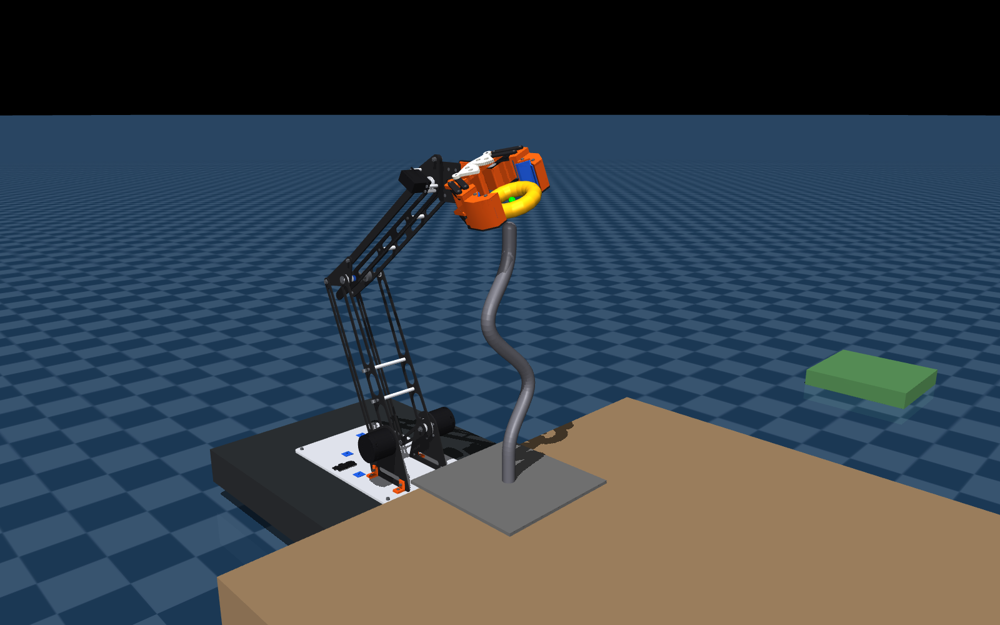
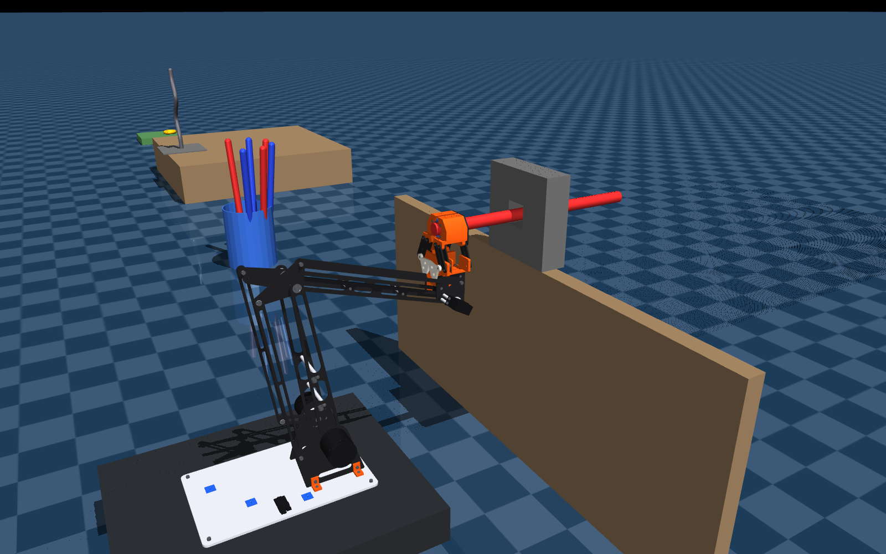
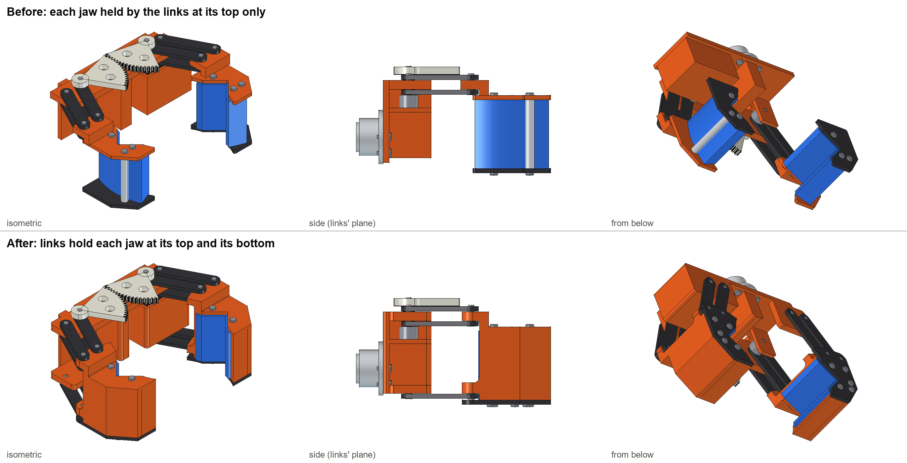
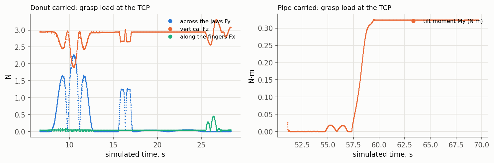
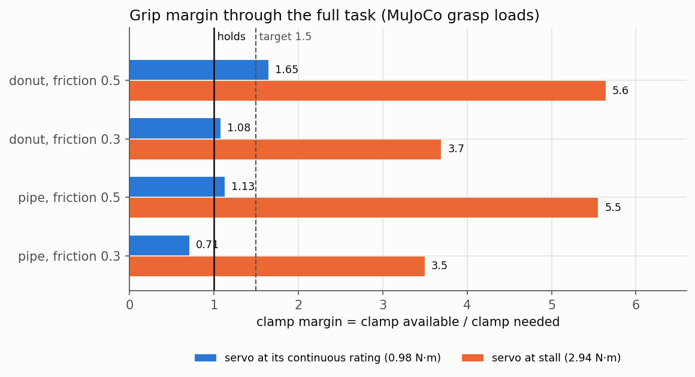
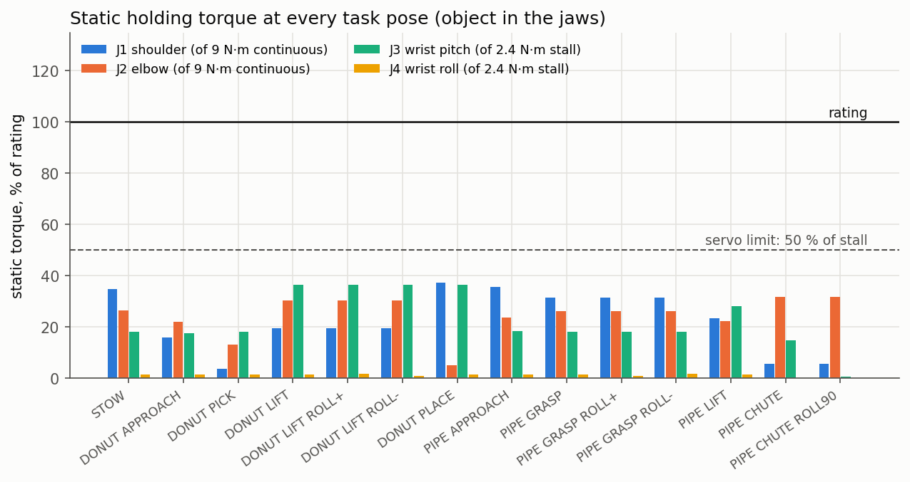
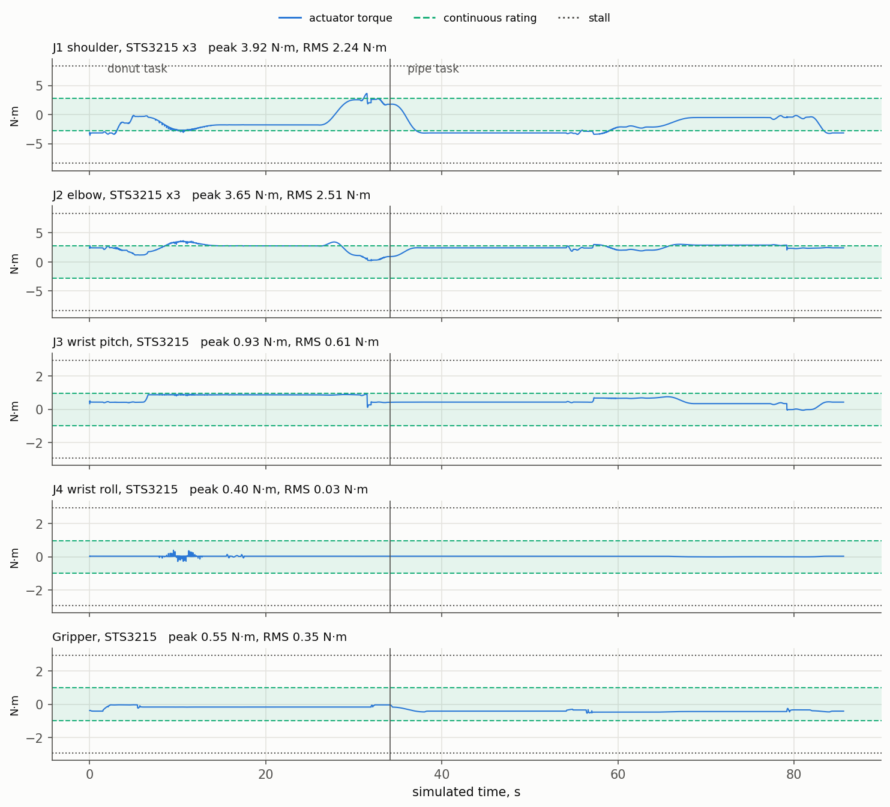
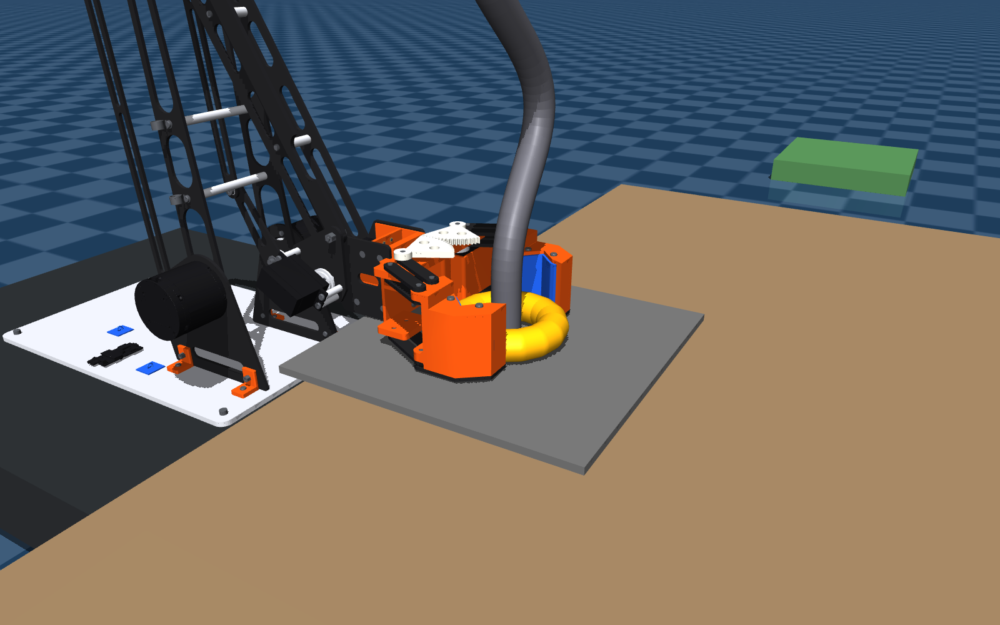
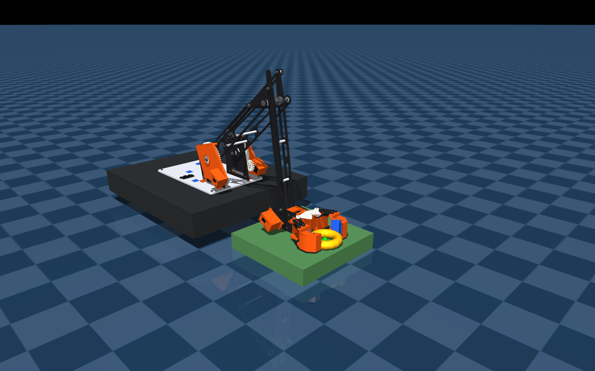
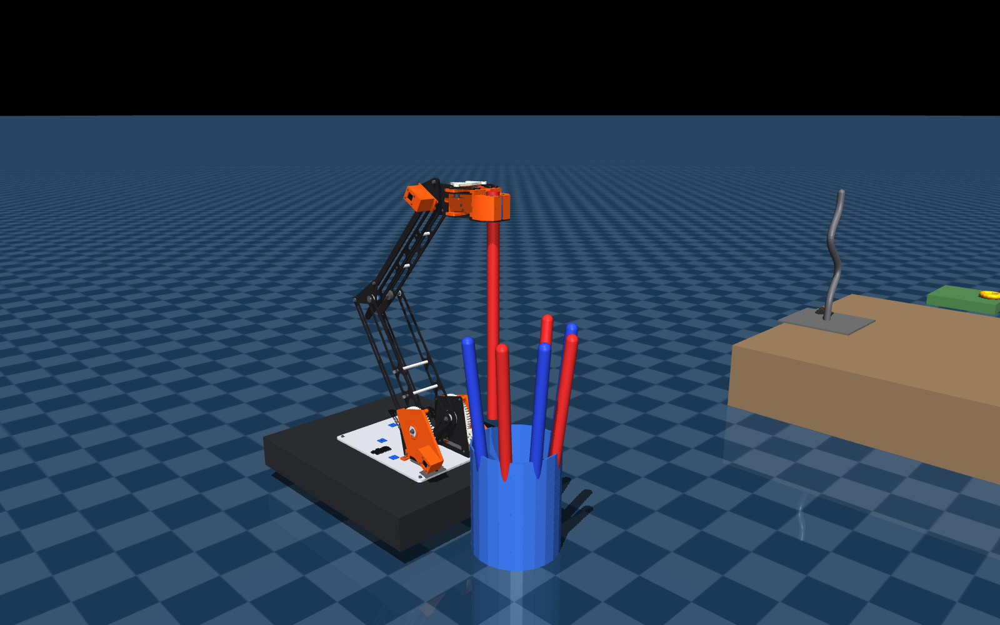

# ARC S2 Engineer arm: mechanical compliance report

Design state (rev B, 2026-11-19): four-bar gripper (`GRIP=FOURBAR`) with the C-frame jaws and the bottom link layer, parallelogram level keeping, and Feetech STS3215 servos on every joint (J1/J2 through a printed 3:1 spur stage on a drive frame per tower).
Every number below comes from a check in this repository; the evidence files are in `cad/out/fourbar/` and `sim/arc_arm_fourbar/`, and `cad/tools/quick_check.py` shows whether each is FRESH against the current design inputs.

## Verdict

| # | Requirement | Verdict | Margin / key number |
|---|---|---|---|
| R1 | Gripper holds the donut through the full task | **PASS** | clamp margin 1.65 at the servo's continuous rating, 5.6 at stall (friction 0.5) |
| R2 | Gripper holds the pipe through the full task | **PASS, with a thermal caveat** | holds within the continuous rating (margin 1.13), 5.6 at stall; target margin at rated is 1.5 |
| R3 | Jaws stay stiff under the grip (pad parallel) | **PASS** | pad bottom moves 0.0006 mm relative to its top (was 1.35 mm); tilt 0.001°; lowest SF 36 |
| R4 | Motors hold the arm at every task pose | **PASS, with a thermal caveat** | worst static torque 81 % of the holding limit (J1: 3.39 of 4.19 N·m, 40 % of stall); but J1/J2 holds exceed the servo's continuous rating (2.79 N·m at the joint) by up to 22 % |
| R5 | Arm actuates effectively through the full task sequence | **PASS, RMS margin tight** | both tasks complete in MuJoCo (85.6 s); peak torque ≤ 47 % of stall; RMS ≤ 90 % of the continuous rating (elbow); peak speed ≤ 72 % of no-load |
| R6 | Parts are strong enough (SF ≥ 1.5 on factored loads) | **PASS** | lowest gripper SF 1.8 (CF drive link at servo stall × 1.25); palm 2.1; arm structure ≥ 3.9 |
| R7 | No collisions; field keep-outs respected; wrist stays level | **PASS** | full interference clear at all poses, moves and the donut lift; level-keeping closure exact |
| R8 | Claw releases within 1 s of power loss (§3.2.4.5) | **OPEN: bench test** | MuJoCo 0.04 s to open 10 mm; depends on the servo's unmeasured back-drive torque |

R2 and R8 are the two items a bench test has to close (see *Open items*).

| Donut carried up the zig-zag pole (wrist rolled 50°) | Pipe driven 300 mm into the chute |
|---|---|
|  |  |

*MuJoCo, full task run (`cad/sim/tasks.py`); the arm's meshes are the CAD parts.*

## Requirements and how they are checked

Source: ARC Championship Events Manual S2 v1.0, §3.2.4 (Objectives B and C) and §3.2.4.5 (Controlling Objectives). Derived requirements and acceptance criteria are ours.

| # | Source | Derived requirement | Acceptance | Check |
|---|---|---|---|---|
| R1 | §3.2.4 Obj C | Pick the Ø100/Ø50×25 donut off the pole base, carry it up the zig-zag pole (chassis strafe + wrist roll up to 50°), place it flat on the scoring area | clamp from the servo ≥ 1.5 × the clamp the carried load needs at the continuous rating, ≥ 2 × at stall | `tools/grip_hold.py` on the MuJoCo grasp wrench |
| R2 | §3.2.4 Obj B | Lift the 500 mm Ø26.7 PVC pipe out of the bucket by its top end, swing it horizontal (wrist pitch 90°), drive it 300 mm into the Ø52.5 chute | as R1 | as R1 |
| R3 | derived | The grip must not tilt the pad (a tilted pad loses the V-notch seat and the donut wrap) | pad bottom moves ≤ 0.25 mm relative to its top, tilt ≤ 0.5°, SF ≥ 1.5, at 1.25 × the servo's stall grip | `fea/run_fea_jaw.py` (multi-material FEA) |
| R4 | derived | Motors hold the arm still at every task pose, with the object | static torque ≤ 50 % of stall at the joint (every joint is an STS3215 hobby servo, no continuous rating; J1/J2 through a 3:1 spur stage) | `tools/quick_check.py` mass/torque, `check_interference.py` §4 |
| R5 | derived | The arm completes both tasks with realistic actuators | tasks complete; peak torque ≤ peak rating; RMS torque ≤ continuous rating; speed ≤ rated speed | `cad/sim/tasks.py` (MuJoCo) |
| R6 | derived | No part yields | SF ≥ 1.5 on gravity/impact loads × 2.5 and actuator-bounded loads × 1.25 | `fea/run_fea.py` (arm, rev B), `fea/run_fea_fourbar.py` (gripper) |
| R7 | §3.2 field + derived | No self-collision; field keep-outs at every pose and along the donut lift; wrist level | 0 overlaps; level closure exact | `check_interference.py`, `tools/check_level_keeping.py`, `envelopes/field.toml` |
| R8 | §3.2.4.5 | A defeated robot is powered off, so the claw must open by itself within 1 s | jaws open far enough to drop the object ≤ 1 s after power loss | spring torque vs servo back-drive (bench); `sim/arc_arm_fourbar/validation.json` power-off release |

Objects: donut 300 g (the sim's value; `params/gripper_fourbar.toml` [GRIP_REQ] once used 150 g, so 300 g is the conservative choice; weigh a real one), pipe 165 g (3/4" Sch40 PVC, 500 mm).

## 1. Gripper audit

### 1.1 The criticism: pads supported only at the top

The four-bar held each jaw only at its top (both link layers sit above the pad), and the TPU pad hung from the printed top finger on three D6 posts down to a CF bottom finger. A grip load low on the pad, where the donut sits, bent that stack about the top.

The multi-material FEA (`fea/run_fea_jaw.py`, servo stall grip × 1.25 = 36.8 N at the donut contact height) confirmed it:

| Design | Pad bottom vs top | Tilt | Lowest SF | Verdict |
|---|---|---|---|---|
| Baseline: top-held jaw, pad on posts | 1.35 mm | 1.68° | 0.53 (PETG-CF top finger) | FAIL |
| Final: C-frame wall + bottom link layer | 0.0006 mm | 0.001° | 36 (CF finger); PETG-CF block < 4 MPa (SF > 10) | PASS |

The earlier single-part FEA of the jaw block (SF 4.1) missed this, because it loaded the posts at the top finger with no lever arm.

The final model fixes the jaw at all six coupler-pin bores (top bores, lower bores, bottom-finger bores) as rigid supports, so the links' and pins' own compliance is not included; the result shows the jaw itself no longer bends. The links are 3 mm CF plates in pairs, and the drive-link FEA in section 4 covers their strength.

### 1.2 The change: jaw held at top and bottom

- **Bottom link layer.** Every drive and idler link has a third 3 mm CF plate low down, so the linkage holds the jaw at its bottom as well as its top. There is no room under the pad (the pole base plate is 3.5 mm under the bottom finger at the donut pick), so the bottom links run behind the pad, just above the bottom finger.
- **Jaw block.** One extrusion of the jaw outline (finger plate plus rounded pin ears), with the pad's footprint, a clevis slot for each link layer and the pole keep-out step cut from it. The cut-out behind the wall blends into the lower pin plate with an R4 inside corner. The result is a C-frame: top finger, rear wall behind the pad, and a lower pin plate.
- **Bottom finger.** Same outline as the block. The lower coupler pins (D4×14) press into it and run in the block above the bottom link: double shear.
- **Pad support.** The rear D6 post is gone; the wall holds the pad's back, and the bottom finger screws to the wall through three M3 heat-set inserts. The pad's back corner has a small notch round the drive-side pin ear (not a grip face).
- **Palm.** A lower ground-pivot layer for the bottom links: the servo cradle's floor is thicker on one side, a matching plate on the other is flush with the top layer above it. Its D4×8 pins stop short of the servo body.
- **Palm.** The bottom-link ground pins press into bores that go through the lower plates (pressed in from below, drifted out from above; no thin skin over a blind bore). Each block that runs out from the mount plate has the same R3 on its free vertical corners, so blocks that share a footprint stay flush; corners on the mount plate stay sharp so no round leaves a groove at the joint. The mount plate's bottom is flush with the lower plates, and its corner relief runs down to the servo cradle's top (no ledges).
- **Cost.** Head 352 g (was 279 g with top-only jaws). Static torques rise by 2–7 % (section 3).



*Gripper head at the donut grip (jaw 100 mm), gripper frame. Black: 3 mm CF links and fingers; orange: PETG-CF prints; blue: TPU pads; white: acetal sector gears.*

Checks on the new geometry: no self-interference over the jaw stroke; envelopes clear at every task pose; hole walls pass (0 broken out, 0 below 1 mm; one 1.35 mm wall warning beside the keep-out step); every screw and pin seated; thread engagement unchanged.

### 1.3 Does the gripper hold the objects?

Method (`tools/grip_hold.py`):

1. MuJoCo runs both full tasks with a kinematic grasp. A weld holds the object to the gripper, and the weld's constraint force is exactly the wrench the jaws must supply (gravity plus inertia). The sim moves it to the TCP and into the gripper frame, then records each component's peak per task phase while the object is carried free. Samples where the object touches the field (lift-off from the pole base, touchdown on the platform) are contact events, not holding cases, and are reported apart.
2. The capacity per newton of clamp comes from the pad geometry: friction on the contact lines, the friction-wedge of the 90° V-notch flanks (pipe) and the R50 arcs (donut), and the pad-end couple for tilting moments on the compliant TPU. Loads across the jaws only shift clamp between them (the jaws are gear-locked), so they count until the far jaw would lose contact.
3. The required clamp is the sum of every component's need (a conservative linear interaction). The available clamp comes from the STS3215's torque through the four-bar, minus the opening spring.

Carried loads (peak, gripper frame at the TCP):

| Object | Along fingers | Across jaws | Vertical | Tilt moment | Where the peak is |
|---|---|---|---|---|---|
| Donut (300 g) | 0.46 N | 2.28 N | 3.32 N | 0.04 N·m | sideways: gravity at the 50° roll on the pole; vertical: weight + lift acceleration |
| Pipe (165 g) | 1.62 N | 0.03 N | 1.65 N | 0.33 N·m | horizontal pipe: its weight 203 mm from the TCP |



*The donut's sideways load peaks while the wrist rolls on the pole; the pipe's tilt moment rises to its static 0.32 N·m as it swings horizontal.*

Result, friction 0.5 (TPU on PVC/PLA, dry; published 0.5–0.8):

| Object | Clamp needed per jaw | Available at rated torque | Available at stall | Margin rated / stall |
|---|---|---|---|---|
| Donut | 5.9 N | 9.7 N | 33.1 N | **1.65 / 5.6** |
| Pipe | 5.3 N | 6.0 N | 29.5 N | **1.13 / 5.6** |



At friction 0.3 (a dusty or oily pad): donut 1.08 / 3.7, pipe 0.71 / 3.5. Both still hold at stall with margin, so even then the servo can hold them by running above its continuous rating for the ~20 s carry.

**Pipe caveat.** The pipe holds within the continuous rating, but with margin 1.13, under the 1.5 target. The cause is the opening spring: it takes 0.48 of the servo's 0.98 N·m at the pipe grip (it winds 63° from open to the pipe). A weaker or less-preloaded spring frees torque:

| Spring | Opening torque at full open | Spring torque at the pipe | Pipe margin at rated |
|---|---|---|---|
| 9271K56, 22° preload (now) | 0.124 N·m | 0.481 N·m | 1.13 |
| 9271K56, 10° preload | 0.056 N·m | 0.413 N·m | 1.28 |
| 9271K52, 22° preload | 0.097 N·m | 0.375 N·m | 1.37 |
| 9271K52, 10° preload | 0.044 N·m | 0.322 N·m | 1.48 |

Which one is allowed depends on R8: the spring's torque at full open must still beat the servo's unpowered back-drive torque. So pick the spring from the bench test.

### 1.4 Release on power loss (R8)

The spring drives the jaws open when the servo is unpowered. The MuJoCo model opens 10 mm in 0.04 s and 90 % in 0.14 s; the (informational) Gazebo model opens 10 mm in 0.55 s. Both depend on the servo's back-drive, which is modelled as an estimate (0.05 N·m friction), so the 1 s rule is **open until the bench test**: measure the STS3215's unpowered back-drive torque and time the release with a donut and a pipe in the jaws.

## 2. Motors hold the arm (R4)

Static joint torques from the modelled masses (`check_interference.py` §4), with the object at the TCP and the pipe at its centre of mass 203 mm along the pipe:

| Joint | Actuator | Stall at the joint | Holding limit (50 % of stall) | Worst static torque | Pose | Utilisation |
|---|---|---|---|---|---|---|
| J1 shoulder | STS3215 + 3:1 spur stage | 8.38 N·m | 4.19 N·m | 3.39 N·m | DONUT_PLACE | 81 % |
| J2 elbow | STS3215 + 3:1 spur stage | 8.38 N·m | 4.19 N·m | 2.90 N·m | PIPE_CHUTE | 69 % |
| J3 wrist pitch | STS3215 | 2.94 N·m | 1.47 N·m | 0.88 N·m | DONUT_LIFT | 60 % |
| J4 wrist roll | STS3215 | 2.94 N·m | 1.47 N·m | 0.04 N·m | — | 3 % |



The STS3215's continuous rating (10 kg·cm, 2.79 N·m at the joint through the 3:1 stage) is below the worst J1 and J2 holds (3.39 and 2.90 N·m). The task's RMS stays within it (section 3), but J1 holds about 3.2 N·m for some 20 s while carrying the pipe, so the base servos will run warm on long holds. Two fixes, if the bench test shows it: a gravity-balance spring on J1/J2 (it carries most of the static torque), or a 4:1 stage (72T gear, R74 tip).

The static model used to put the pipe's mass at the TCP. That hid its 0.33 N·m moment on the wrist pitch once the pipe is swung horizontal (PIPE_CHUTE showed 0.01 N·m; it is 0.35). The check now uses the pipe's centre of mass.

## 3. The arm actuates effectively (R5)

MuJoCo runs both full tasks (`cad/sim/tasks.py`, actuators as position servos with velocity feed-forward, joint moves at half the speed limits, the pipe swing at a quarter). Both succeed: the donut lands flat on the platform (centre within 1 mm of the CAD place pose) and the pipe ends 297 mm into the chute. 85.6 s simulated, including the chassis drives (74.6 s with the earlier, faster joint motors: the 3:1 STS3215 drives cost about 11 s); joint tracking within 0.84°.

| Joint | Peak torque | vs stall | RMS torque | vs continuous | Peak speed | vs no-load speed |
|---|---|---|---|---|---|---|
| Shoulder | 3.92 N·m | 47 % of 8.38 | 2.24 N·m | 80 % of 2.79 | 1.13 rad/s | 72 % of 1.57 |
| Elbow | 3.65 N·m | 44 % of 8.38 | 2.51 N·m | 90 % of 2.79 | 0.94 rad/s | 60 % of 1.57 |
| Wrist pitch | 0.93 N·m | 31 % of 2.94 | 0.61 N·m | 62 % of 0.98 | 1.14 rad/s | 24 % of 4.7 |
| Wrist roll | 0.40 N·m | 13 % of 2.94 | 0.03 N·m | 3 % of 0.98 | 2.45 rad/s | 52 % of 4.7 |
| Gripper | 0.55 N·m | 19 % of 2.94 stall | 0.35 N·m | 35 % of 0.98 | 2.35 rad/s | 50 % of 4.7 |



*Torque at every joint through both tasks against the actuator ratings (dashed: continuous rating; dotted: stall; J1/J2 at the joint, through the 3:1 stage). The gripper's trace is the jaw motion only (the grasp is a weld in the sim).*

| Donut gripped on the pole base | Donut placed on the platform | Pipe lifted out of the bucket |
|---|---|---|
|  |  |  |

Rated speeds: STS3215 0.222 s/60° at 12 V (4.7 rad/s); J1/J2 through the 3:1 stage 1.57 rad/s.

**Correction to earlier numbers.** Earlier runs reported shoulder 11.7 and elbow 18.9 N·m peaks and a 1.15 N·m pipe moment. Those were a sim artefact: each 10 ms setpoint was applied as a step, so the stiff joint servos were kicked at 100 Hz (the grasp moment alternated sign every control period). The sim now ramps each setpoint across the physics substeps, as a drive interpolates its command stream, and every load now matches hand calculation (the pipe's median moment is its static 0.324 N·m).

The gripper torque in this table is the jaw motion only: the sim's grasp is a weld, so clamp torque is covered by section 1.3, not here.

## 4. Strength (R6)

Arm structure (rev B, `fea/out/fea_report.md`, loads × 2.5): upper arm SF 3.9, forearm 9.7, clevis 46, J2 hub 72 (now held on its hex by the 54T gear), roll housing 62 (with the STS3215 pocket). The upper arm's SF was 7.2 in rev A; that run predates the current upper-arm plate and level-keeping linkage, so 3.9 is the current geometry's value. These were sized for a 1.0 kg head plus payload; the four-bar head plus the 300 g donut is 0.65 kg, so they remain conservative.

Gripper (`fea/run_fea_fourbar.py`, actuator loads × 1.25, external loads × 2.5):

| Part | Material | Load | Peak stress | SF |
|---|---|---|---|---|
| Drive link (CF 3 mm) | CF quasi-isotropic, 200 MPa | servo stall reacted at the coupler pin, 78 N | 111 MPa | 1.8 |
| Jaw block | PETG-CF, 40 MPa | stall grip 37 N on the top finger's posts, jaw held at top and bottom | 2.5 MPa | 16 (was 4.1 before the bottom links) |
| Palm | PETG-CF, 40 MPa | head 0.35 kg + pipe + 0.5 N·m moment × 2.5 = 117 N at the pivots | 18.7 MPa | 2.1 |
| Sector gear tooth | acetal, 60 MPa | half stall torque through the mesh (Lewis) | 22 MPa | 2.7 |
| Pivot pins D4 | 52100 steel | 78 N single shear | 6 MPa | 161 |
| Link bore bearing | CF | 78 N on a 4 × 3 mm bore | 6.5 MPa | 31 |
| Jaw as a whole (section 1.1) | multi-material | stall grip at the donut height | — | ≥ 36 |

Level keeping, rod 2: buckling 313 N against a worst load of 134 N (SF 2.35), shear-out at the eyes about 2.4 kN.

## 5. Collisions, keep-outs and level keeping (R7)

- Full interference (`check_interference.py`): 0 overlaps at STOW (all part pairs), 0 across the 14 task poses and the moves between them.
- Field clearance at all 13 task poses, and the donut lift up the pole (25 samples, strafe −51…49 mm): clear.
- Level keeping (`tools/check_level_keeping.py`): closure exact; dead-point margin ≥ 24.7° (21.3° at the joint limits); elbow sweep clean; wrist pitch clear to 96° at PIPE_CHUTE (needs 93°).

## Open items

1. **Servo back-drive and release bench test (R8, R2).** Measure the STS3215's unpowered back-drive torque, time the power-off release with each object in the jaws, then choose the spring from the table in 1.3 (the weakest that still releases in under 1 s).
2. **Pipe-hold servo temperature (R2).** Hold the pipe horizontal for 30 s and log the servo's temperature and load readback; it should stay inside its continuous rating.
3. **Pad friction.** Measure the TPU pad's friction on PVC and on a printed donut; the hold margins assume 0.5.
4. **Donut mass and the zig-zag pole.** Weigh a real donut (300 g assumed). The pole is still a placeholder (manual: TBA); re-run `check_interference.py` and the sim when the drawing lands.
5. **STS3215 drives on the bench.** Check the printed 18T/54T stage for backlash and tooth wear under the J1/J2 holding load, and log the J1/J2 servo temperature through a full pipe task: their holds run up to 22 % over the continuous rating (section 2). If they overheat, add a gravity-balance spring or go to a 4:1 stage.
6. **Purchased parts to confirm.** McMaster part number for the new D4×8 ground pins (`data/catalogue.toml`).

## Recommendations

- Plan moves with an acceleration limit, as the sim does (min-jerk, timed by speed and with setpoints interpolated); keep the pipe swing slow (a quarter of the joint speed limits).
- Pick the gripper spring from the bench test (section 1.3) to raise the pipe-hold margin.
- Gazebo is informational only; MuJoCo is the validated simulator.

## How to reproduce

```
python -I cad/tools/run.py --grip FOURBAR cad/tools/quick_check.py
python -I cad/tools/run.py --grip FOURBAR cad/check_interference.py
python -I cad/tools/run.py --grip FOURBAR cad/tools/check_level_keeping.py
python -I cad/tools/run.py --timeout 7200 --grip FOURBAR cad/fea/run_fea_jaw.py        (JAW_CASE=final JAW_H=2.5)
python -I cad/tools/run.py --timeout 7200 --grip FOURBAR cad/fea/run_fea_fourbar.py
python -I cad/tools/run.py --grip FOURBAR cad/sim/export_robot.py
<sim python> cad/sim/build_robot.py fourbar ; <sim python> cad/sim/build_tasks.py fourbar
<sim python> cad/sim/tasks.py --task both --no-viewer
python -I cad/tools/grip_hold.py
```

Figures (`cad/docs/figures/`):

```
<sim python> cad/sim/tasks.py --task both --no-viewer --log sim/arc_arm_fourbar/task_log.npz --snap cad/docs/figures
"<FreeCAD 1.1>/bin/python.exe" -I cad/docs/make_plots.py                                   (plot_*.png)
python -I cad/tools/run.py --grip FOURBAR cad/tools/report_figures.py <dir>/head_new.FCStd  (and in a checkout of 28ad21e: head_old)
FreeCAD GUI: exec(open("cad/tools/report_figures.py").read()); render(...) per head; compose(<dir>, "cad/docs/figures/gripper_before_after.png")
```
